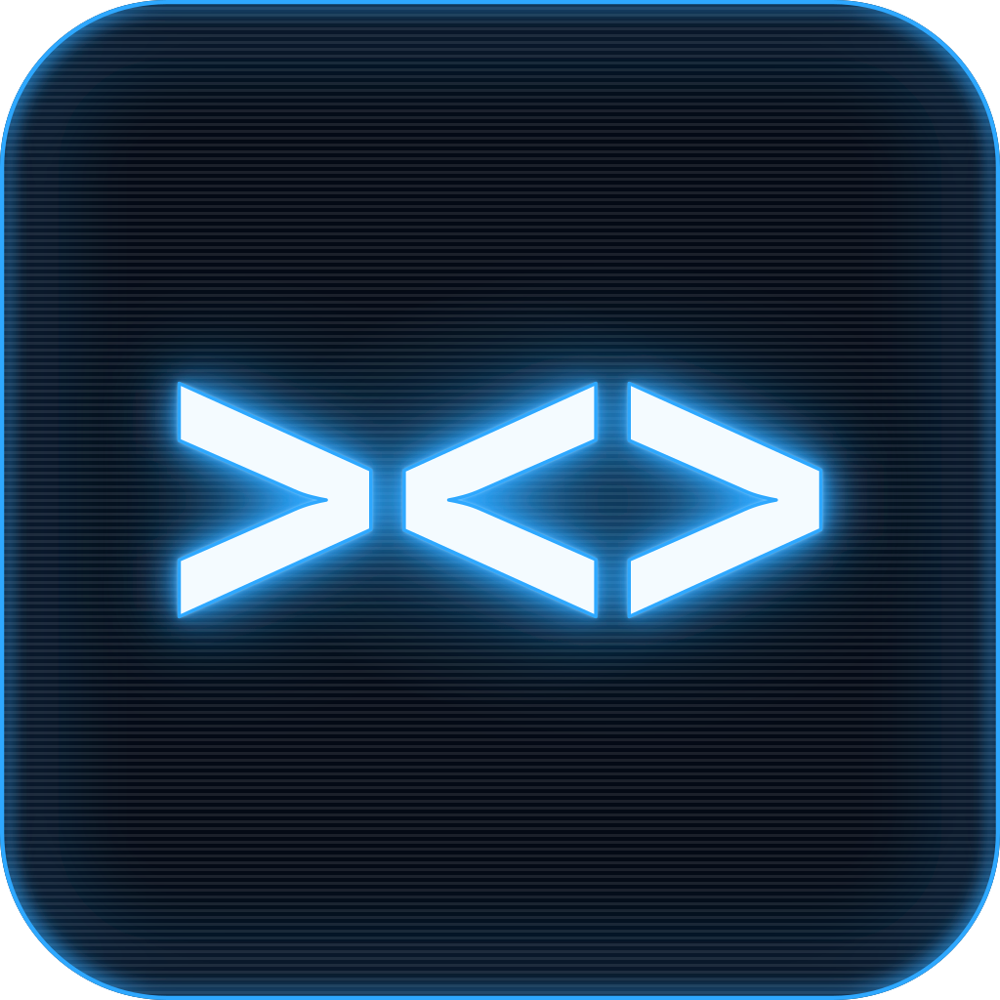
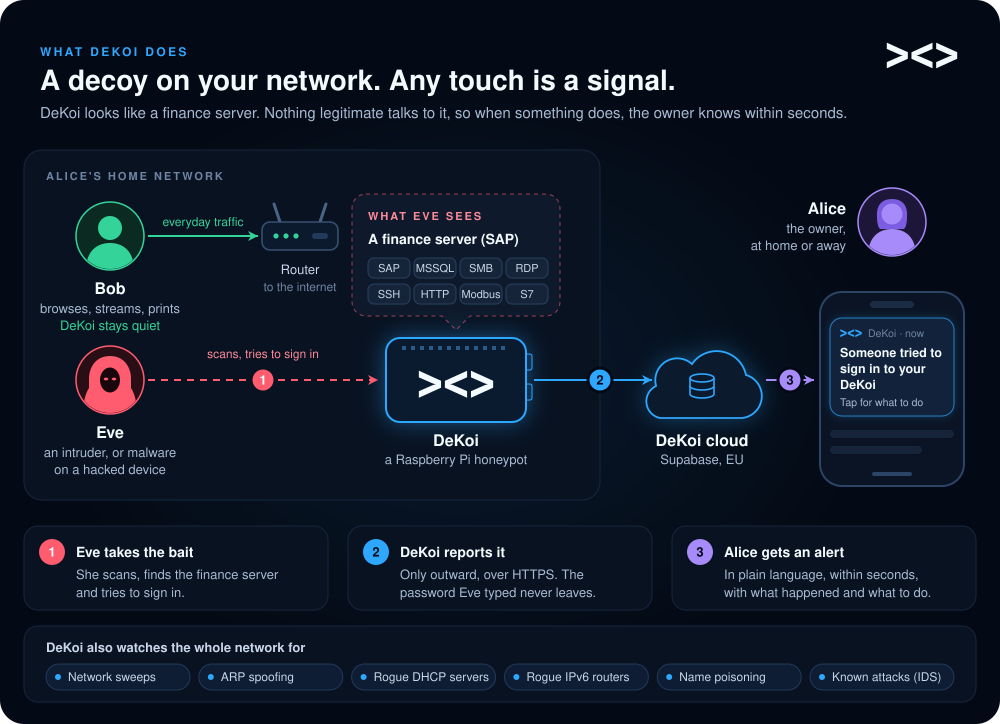
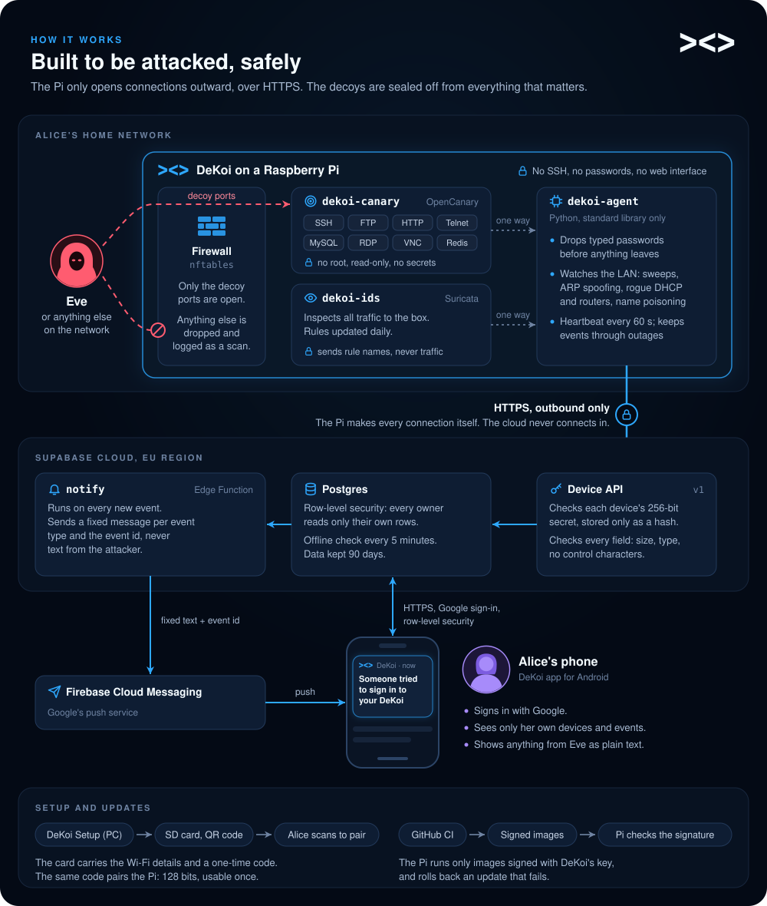
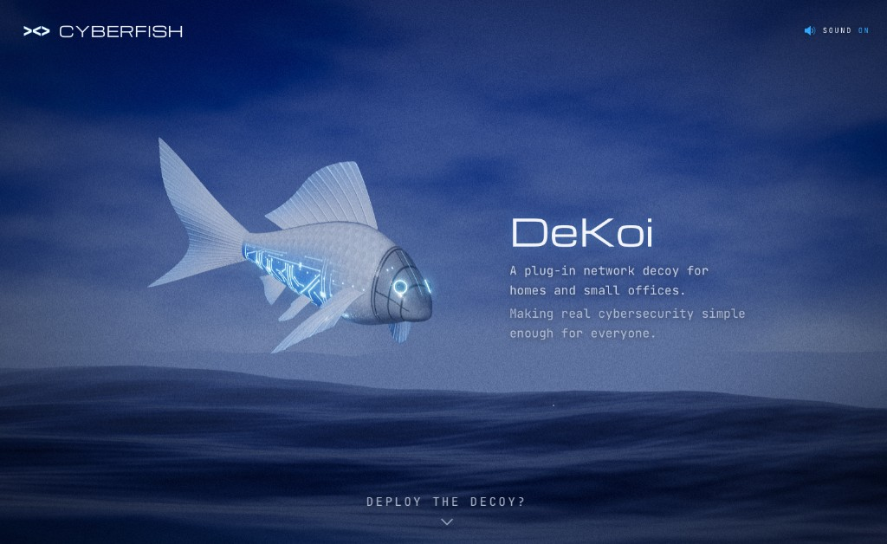

  

# DeKoi by CyberFish

A plug-and-play network honeypot and intrusion detector. A Raspberry Pi poses
as a small company's finance server on the local network; nothing legitimate
talks to it, so any contact is a signal. It also runs an IDS and watches the
network for sweeps, ARP spoofing, rogue DHCP servers and routers, and name
poisoning. The owner gets a plain-language alert on their phone.

## How it works

The contracts behind this picture are in `docs/architecture.md`; the evidence
for each security claim is in `docs/security.md`.

| Directory   | What it is                                                     |
| ----------- | -------------------------------------------------------------- |
| `backend/`  | Supabase project: migrations, RLS, RPCs, Edge Function, tests  |
| `device/`   | Everything that runs on the Pi: decoys, IDS, agent, host config |
| `clients/`  | Gradle root: Android app, DeKoi Setup (SD-card tool), shared   |
| `docs/`     | Build brief, status, architecture, security, decisions         |

Each component README has its build, test and run commands.

Start with `docs/PROMPT.md` (what is being built) and `docs/STATUS.md` (where
it stands).

## The 3D DeKoi

The CyberFish landing page is a three.js scene with DeKoi as its mascot. It
was built during the hackathon as the visual for the pitch and as a starting
point for an advertising campaign. It is a separate asset, not part of the
product, so it lives in its own repository:
[nevermindmae/cyberfish-landing-page](https://github.com/nevermindmae/cyberfish-landing-page).
It follows the same rules as this repository.
